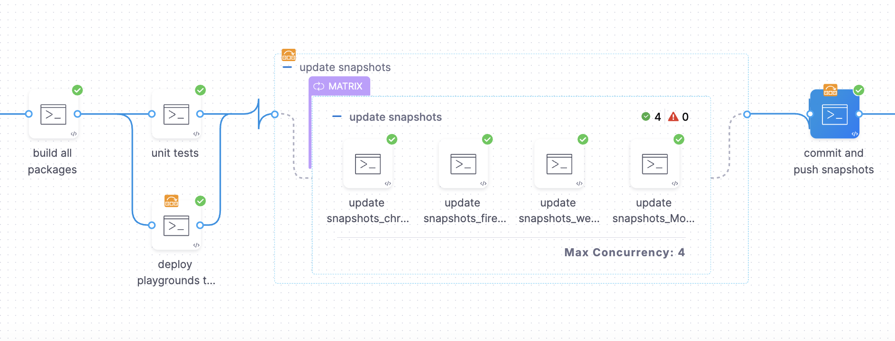
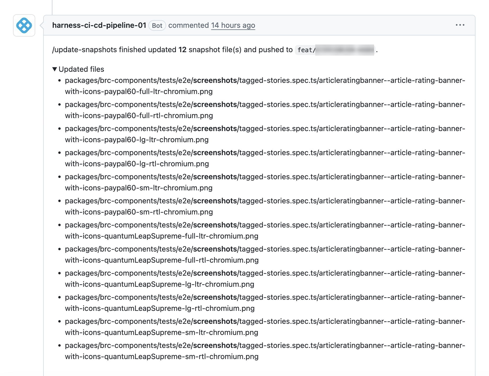

**TL;DR:** We test our React components with about 3,400 screenshots of them rendered in Storybook, in four browsers and several brand themes. Four practices keep them trustworthy: screenshots are only ever generated in CI; fonts, images and videos are served from the repo; adding a visual test is becoming a one-line change; and CI runs as much of the suite as a change actually risks. Even with all of that, I found a set of screenshots this week that had been passing while showing a bug.

---

## The Problem With Visual Tests

I'm a Staff Software Engineer at PayPal, working on a monorepo of React component libraries. They provide the sections and components behind every logged-out page of paypal.com and venmo.com, [more than 6,500 pages](/experience/2023-paypal/).

This post is about testing those components. Each test opens a component's story in Storybook and screenshots it: either the component itself or the whole story.

Visual tests are the cheapest way to catch the bugs unit tests miss: a padding change that shifts a whole section, a font that silently falls back to Arial, a theme token that turns a button the wrong shade of blue.

They are most valuable when a change is not supposed to change anything visible. Upgrading dependencies, moving to a new Storybook version or swapping the build toolchain should leave every component looking exactly the same. Without visual tests, confirming that means clicking through hundreds of stories by hand. With them, you get the full list of components that look different, in every browser and theme, before the change is merged.

That only works if people believe the results. Visual test suites usually lose that trust in two ways.

**Noise.** The test fails, but the code change had nothing to do with it. The difference is real in the image, but it comes from the test run itself: the web font hadn't finished loading, so the text was captured in a fallback font; an animation was caught mid-frame; a scroll-triggered entrance hadn't started yet. After a few false alarms like these, people stop investigating failures and simply regenerate the screenshots to get a green pipeline.

The wrong screenshot is now committed and lives in the repo. Later, when someone ships the correct behavior, the test fails against it, and the correct change is the one that looks broken.

**Drift.** The screenshot was generated on someone's laptop, and CI runs Linux. Font rendering, antialiasing and scrollbars all differ slightly, or content ends up shifted by a few pixels at the top or bottom. Either the tolerance gets raised until real bugs slip through, or every PR turns into a fight with pixels.

Everything below is a response to one of these two.

## Screenshots Only Come From CI

The rule is simple: nobody commits a screenshot generated on their own machine. It's written in our testing docs, but a rule only holds if following it is easier than breaking it. So I built a pipeline for it.

On any pull request, a developer can comment:

```
/update-snapshots
```

The name comes from Playwright's `--update-snapshots` flag. The pipeline first checks that the commenter has write access to the repo. Then it runs our regular build and validation pipeline, with one difference: instead of comparing new screenshots against the committed ones, it regenerates them, either all of them or only the specs named in the comment (e.g. `/update-snapshots Hero Accordion`). It runs inside the same pinned Playwright Docker image the PR checks use, one job per browser in parallel. Then it commits the changed screenshots to the PR branch under the commenter's name and replies on the PR with the list of files it changed.


Why this matters:

- **Drift goes away.** The environment that creates a screenshot is the same one that checks it, so there is nothing to drift between.
- **A visual change becomes a reviewable step.** The updated screenshots land in the PR diff, GitHub shows the before and after side by side, and the commit says who asked for it.
- **Fixing a failing PR no longer takes an afternoon.** Before, updating screenshots meant launching Rancher Desktop (a local Docker runtime), starting a container, starting Storybook inside it and running the update by hand. You had to check out the branch locally, so when several PRs were failing, someone went through them one by one, checking out other people's branches. Now anyone can drop the comment on any PR and move on while the pipeline works.

This makes regenerating screenshots as cheap as it gets, which is exactly the habit I warned about above. It's safe only because the result is not a silent fix: the new screenshots are a diff in the PR, and a reviewer has to approve it.

## The CI Environment Matters as Much as the Tests

Our pipelines used to run on Jenkins. After the move to a monorepo, I took on the second step of the migration: I made the monorepo package-agnostic and replaced one large Jenkins configuration with a set of simple Harness pipelines (Harness is our CI/CD platform). Adding a new package now needs no pipeline changes at all.

For visual tests, the new pipelines brought three things: a more stable environment, parallel jobs (each browser runs as its own job), and the option to give heavy steps more resources. Every run also starts in a fresh, pinned container, so one run can't leave state behind for the next.

That stability is what made the rest possible. Practices like CI-only screenshots only work when the environment produces the same pixels every time. On an environment that's itself unreliable, every failure is a debate about whether the test or the machine is to blame.



## Control Everything a Screenshot Depends On

A screenshot depends on more than your code. Images, web fonts and videos all come from PayPal's CDN. These assets rarely change. The real problem is that they don't load consistently: a request is slow or drops, and Playwright's "network idle" signal doesn't reliably wait for it. The result was the worst kind of flakiness: the same PR fails twice and goes green on the third run.

So every test runs through a shared Playwright fixture that intercepts those requests and answers the ones it recognizes with files checked into the repo:

- fonts are served from a local copy;
- content images that carry an aspect ratio in the URL are replaced with placeholders of that ratio, so the layout gets tested without depending on what the photo shows;
- known logos and app badges map to fixed stand-ins;
- videos that carry an aspect ratio in the URL are replaced with a placeholder clip of that ratio.

Anything the fixture doesn't recognize still goes to the network. The placeholder lookup keys on an `aspect-ratio` query parameter in the asset URL. Simplified, the image handler looks like this:

```ts
await page.route(/\.(jpe?g|png|webp|avif|svg)/i, async (route) => {
  const url = new URL(route.request().url());
  try {
    if (url.searchParams.has('aspect-ratio')) {
      const ratio = url.searchParams.get('aspect-ratio').replace(':', '-'); // "16:9" -> "16-9"
      const body = fs.readFileSync(`./tests/utils/media-assets/images/${ratio}.png`);
      return await route.fulfill({ contentType: 'image/png', body });
    }
    // known logos and badges map to fixed files here
    return await route.continue();
  } catch {
    return await route.abort();
  }
});
```


Engineers writing a test don't have to think about any of this, so stable screenshots come for free to everyone on the team. They import `test` from the shared fixture instead of from Playwright, and a lint rule blocks the direct import, so nobody can skip the interceptors by accident.

## Adding a Visual Test Should Take One Line

Today, most of our components have a hand-written spec: a list of stories, a list of themes, wait for the container, scroll, take the screenshot. It works, but it means 56 spec files, and coverage depends on someone remembering to write the next one.

We're currently trying a different approach, where a visual test is a Storybook tag:

```tsx
export default {
  title: 'ArticleRatingBanner',
  component: ArticleRatingBanner,
  tags: ['e2e'],
};
```

A single spec file reads the Storybook index, finds every story tagged `e2e`, and screenshots it in 2 brand themes, at 3 viewport widths (375, 1024 and 1920 pixels), in both left-to-right and right-to-left layouts. That's 12 screenshots per story with no test code. A story that shouldn't be tested opts out with `!e2e`.

```ts
const index = await fetchStoryIndex(STORYBOOK_DATA.url);
const stories = requireTaggedStories(index, E2E_TAG, STORYBOOK_DATA.url);

stories.forEach((story) => {
  STORY_VARIANTS.forEach((variant) => {
    const { foundationTheme, viewport, direction } = variant;

    test(`${story.id} ${foundationTheme} ${viewport.name} ${direction}`, async ({ page }) => {
      await page.setViewportSize({ width: viewport.width, height: viewport.height });
      await page.emulateMedia({ reducedMotion: 'reduce' });
      await navigateTo(buildStoryArgs(story.id, variant), page);
      await waitForImagesToLoad(page);

      await expect(page).toHaveScreenshot(
        `${story.id}-${foundationTheme}-${viewport.name}-${direction}.png`,
        { fullPage: true },
      );
    });
  });
});
```



How much coverage you get depends mostly on how much it costs to add. When it's one word in a file the developer already has open, people add it. Right-to-left is a good example: almost nobody writes RTL tests by hand, and RTL layout bugs are exactly the kind a visual test catches.

The tag also separates what to test from how to test it. Because all the testing logic lives in one place, a new kind of check can be rolled out to every tagged story with a single change. If we decide tomorrow to capture each story with JavaScript disabled, or to compare it with reduced motion on and off, nobody has to touch a single story or spec.

## Run the Right Amount, at the Right Time

Running every visual test in four browsers on every PR would be slow and expensive. Running too little lets breakage through. We split it into two levels:

- **Pull requests** run visual tests only for the packages the change affects. A docs change runs none, and a change to one package doesn't retest the others.
- **Before every release**, a separate pipeline runs the full suite with no filtering. Two PRs can each pass on their own and break something together, and this is where that gets caught.

There is also one small safety check. Playwright only works with the exact browser builds released alongside its version, and our CI image ships those browsers pre-installed. If someone upgrades Playwright in the repo but not the image, the tests can't launch a browser at all and fail with an error that doesn't explain why. So before running anything, CI compares the two versions and, if they don't match, fails with a message that says exactly which one to bump.

## When a Green Test Was Wrong

This week I was adding visual tests for a new section component. The tests were green. When I opened the screenshots, everything below the first screen had empty image frames: the right layout, the right boxes, and no images inside them.


The cause: a full-page screenshot includes the whole story, top to bottom, but the browser only loads lazy images once they get close to the viewport. Our images are lazy in two ways: native `loading="lazy"`, and a wrapper component that doesn't render the image at all until it scrolls into view. Our "wait for images" helper waited for every image on the page to finish loading, but images that hadn't been rendered yet weren't on the page to wait for.

The fix: before waiting, the helper now scrolls through the page one screen at a time so the lazy wrappers render, switches native lazy images to eager, and only then waits for the network and the images:

```ts
await page.evaluate(async () => {
  for (let y = 0; y < document.documentElement.scrollHeight; y += window.innerHeight) {
    window.scrollTo(0, y);
    await new Promise((resolve) => setTimeout(resolve, 100));
  }
  window.scrollTo(0, 0);

  document.querySelectorAll<HTMLImageElement>('img[loading="lazy"]').forEach((img) => {
    img.loading = 'eager';
  });
});

await page.waitForLoadState('networkidle');
await page.waitForFunction(() => Array.from(document.images).every((img) => img.complete));
```

Network idle is only one of the waits here. With content images served locally it settles quickly, and the final check on every image is what actually guarantees they're loaded. The screenshots now show what a user sees after scrolling.

The test was doing exactly what it was told. It compared the story against the committed screenshot, and that screenshot was wrong. Our tooling doesn't catch that, but a person looking at the screenshot can. That's the part of `/update-snapshots` I care about most: it puts the screenshot in the PR, where someone has to look at it.

## Trade-offs and Limits

- **The tolerance is generous.** A new screenshot can differ from the committed one by up to 4% of its pixels before the test fails. That keeps run-to-run noise down, but it also means a change confined to a small area can pass unnoticed. A button turning from blue to red is a big color difference per pixel, yet in a screenshot of a whole section that button may cover well under 4% of the image, so the test stays green.
- **Screenshots pile up.** We carry about 3,400 screenshots, and every visual change means reviewing a stack of images. We keep the pile under control by deprecating themes and components we no longer need, and by moving to the tag-driven approach, which gives broader coverage per line of code than hand-written specs.
- **One recipe doesn't fit everything.** Sticky headers and fixed elements end up in the wrong place in full-page screenshots, complex animations need custom waiting, and some components need interaction (open a menu, switch a tab) before there's anything worth capturing. Those still need hand-written specs. The tag covers the common case, not every case.

## Takeaways

Trust in a visual test suite builds up over time: from a stable environment, from cutting the noise to a minimum, and from people actually looking at the screenshots. Once it's there, a visual test failure stops being a checkbox to clear and becomes the first place we look when a component library change goes wrong.

We can see it in how failures behave now: a failing visual test step no longer turns green after a few reruns. If it fails, somebody has to go and look at it.

**Look at the images.** A passing visual test proves the story matches the committed screenshot, not that the screenshot is right. It's the same lesson I took from [auditing docs with AI](): the tool does the work, and a person still has to check it.

## What's Next

Next on our list is running only the specs affected by a change, not every spec in an affected package. That should make PR runs faster still. The risk is low because the full-suite run is still there as a safety net, so in the worst case a problem is caught a bit later, and that run could move to a nightly build. If you've done test-level selection for visual tests, I'd especially like to hear how it went.

## How Do You Do It?

If you run visual tests differently (a hosted service like Chromatic or Percy, screenshots of real pages instead of isolated components, or no screenshots at all), I'd like to hear about your experience, including the parts where you think we got it wrong.
