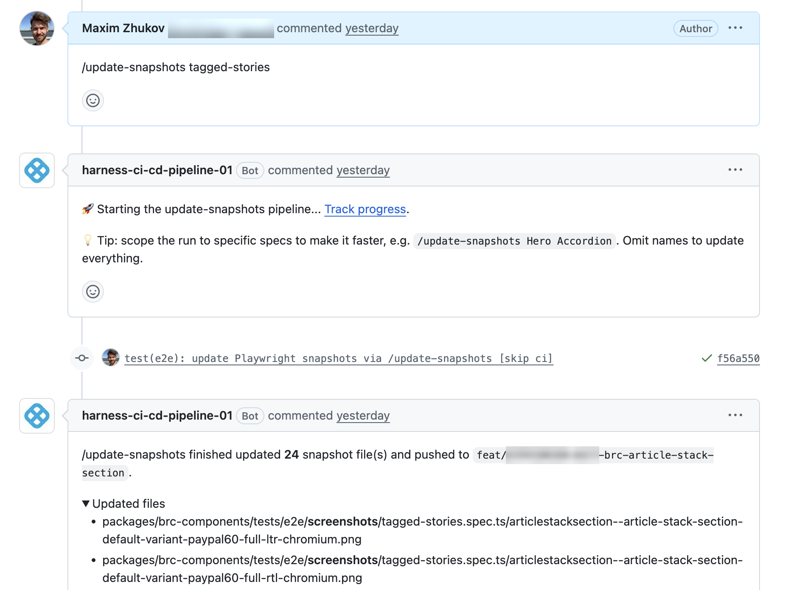
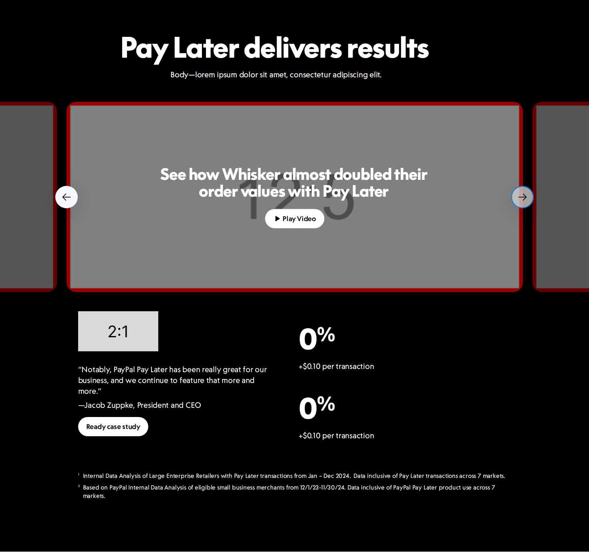
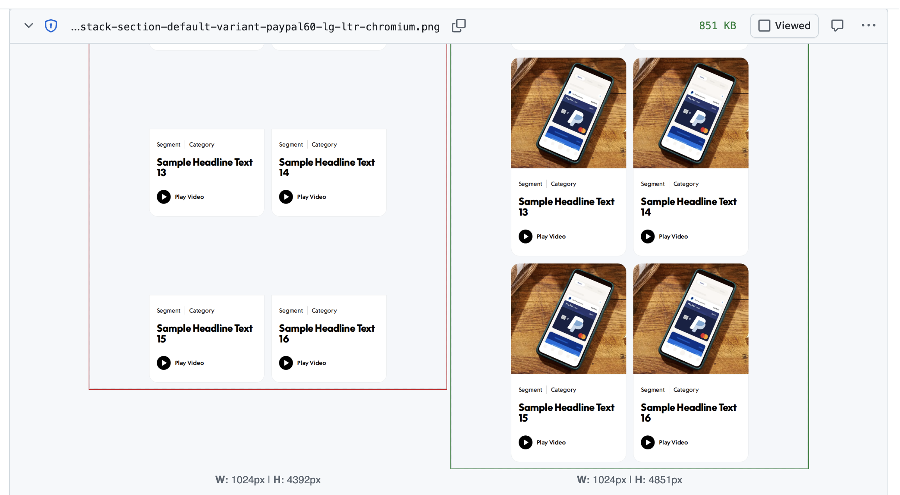

**TL;DR:** We keep about 3,400 screenshot baselines across the component libraries behind 6,000+ paypal.com and venmo.com home and marketing pages, in four browsers and several brand themes. Four practices keep them trustworthy: baselines are only ever generated in CI, every external asset is served from the repo, adding a visual test is a one-line change, and CI runs as much of the suite as a change actually risks. Even with all of that, I found a set of baselines this week that had been passing while showing a bug. A green screenshot test is only as good as the review of its baseline.

---

## The Problem With Screenshot Tests

I work on a monorepo of React component libraries used on paypal.com, venmo.com and by several backend platforms, such as BRC and marketing (the same libraries whose docs I [audited with AI]()). Screenshot tests are the cheapest way to catch the bugs unit tests miss: a padding change that shifts a whole section, a font that silently falls back to Arial, a theme token that turns a button the wrong shade of blue.

They are most valuable when a change is not supposed to change anything visible. Upgrading dependencies, moving to a new Storybook version or swapping the build toolchain should leave every component looking exactly the same. Without screenshot tests, confirming that means clicking through hundreds of stories by hand. With them, you get the full list of components that look different, in every browser and theme, before the change is merged.

That only works if people believe the results. Screenshot suites usually lose that trust in two ways.

**Noise.** The test fails, but the code change had nothing to do with it. The difference is real in the image, but it comes from the test run itself: the web font hadn't finished loading, so the text was captured in a fallback font; an animation was caught mid-frame; an animation that starts when the section scrolls into view hadn't started yet. After a few false alarms like these, people stop investigating failures and simply regenerate the baselines to get a green pipeline.

That is worse than it sounds. The wrong baseline is now committed and lives in the repo. Later, when someone ships the correct behavior, the test fails against the wrong baseline, and the correct change is the one that looks broken.

**Drift.** The baseline was generated on someone's laptop, and CI runs Linux. Font rendering, antialiasing and scrollbars all differ slightly, or content ends up shifted by a few pixels at the top or bottom. Either the tolerance gets raised until real bugs slip through, or every PR turns into a fight with pixels.

Everything below is a response to one of these two.

## Baselines Only Come From CI

The rule is simple: nobody commits a screenshot generated on their own machine. It's written in our testing docs, but a rule only holds if following it is easier than breaking it. So I built a pipeline for it.

On any pull request, a developer can comment:

```
/update-snapshots
```

This runs our regular build and validation pipeline, with one difference: instead of comparing screenshots against the baselines, it regenerates them, either all of them or only the specs named in the comment (e.g. `/update-snapshots Hero Accordion`). It runs inside the same pinned Playwright Docker image the PR checks use, one job per browser in parallel. Then it commits the changed images to the PR branch under the commenter's name and replies on the PR with the list of files it changed.



Why this matters:

- **Drift goes away.** The environment that creates a baseline is the same one that checks it, so there is nothing to drift between.
- **A visual change becomes a reviewable step.** The updated screenshots land in the PR diff, GitHub shows the before and after side by side, and the commit says who asked for it.
- **Fixing a failing PR no longer takes an afternoon.** Before, updating baselines meant launching Rancher Desktop, starting a container, starting Storybook inside it and running the update by hand. You had to check out the branch locally, so when several PRs were failing, someone went through them one by one, checking out other people's branches. Now anyone can drop the comment on any PR and move on while the pipeline works.

## Control Everything the Screenshot Depends On

A screenshot depends on more than your code. Images, web fonts and videos all come from PayPal's CDN, and there are decorative shapes on top. These assets rarely change. The real problem is that they don't load consistently: a request is slow or drops, and Playwright's "network idle" signal doesn't reliably wait for it. The result was the worst kind of flakiness: the same PR fails twice and goes green on the third run.

So every test runs through a shared Playwright fixture that intercepts those requests and answers them with files checked into the repo:

- fonts are served from a local copy;
- content images are replaced with placeholders of the requested aspect ratio, so the layout gets tested without depending on what the photo shows;
- known logos and app badges map to fixed stand-ins;
- videos get the same treatment.



In one of our libraries, an intercepted image or video that has no matching local file fails the test, instead of quietly falling back to the network. A silent fallback is how flakiness creeps back in, so we made it loud.

Engineers writing a test don't have to think about any of this. They import `test` from the shared fixture instead of from Playwright, and a lint rule blocks the direct import, so nobody can skip the interceptors by accident.

## Adding a Visual Test Should Take One Line

Today, most of our components have a hand-written spec: a list of stories, a list of themes, wait for the container, scroll, take the screenshot. It works, but it means 56 spec files per library, and coverage depends on someone remembering to write the next one.

In one library we're trying a different approach, which we plan to bring to the others. There, a visual test is a Storybook tag:

```tsx
export default {
  title: 'PullQuoteSection',
  tags: ['e2e'],
};
```

A single spec file reads the Storybook index, finds every story tagged `e2e`, and screenshots it in 2 foundation themes, at 3 viewport widths (375, 1024 and 1920 pixels), in both left-to-right and right-to-left layouts. That's 12 screenshots per story with no test code. A story that shouldn't be tested opts out with `!e2e`.


How much coverage you get depends mostly on how much it costs to add. When it's one word in a file the developer already has open, people add it. Right-to-left is a good example: almost nobody writes RTL tests by hand, and RTL layout bugs are exactly the kind a screenshot catches.

The tag also separates what to test from how to test it. Because all the testing logic lives in one place, a new kind of check can be rolled out to every tagged story with a single change. If we decide tomorrow to capture each story with JavaScript disabled, or to compare it with reduced motion on and off, nobody has to touch a single story or spec.

## Run the Right Amount, at the Right Time

Running every screenshot in four browsers on every PR would be slow and expensive. Running too little lets breakage through. We split it into two levels:

- **Pull requests** run visual tests only for the packages the change affects. A docs change runs none, and a change to one library doesn't retest the others.
- **Before every release**, a separate pipeline runs the full suite with no filtering. Two PRs can each pass on their own and break something together, and this is where that gets caught.

There is also one small safety check. Playwright only works with the exact browser builds released alongside its version, and our CI image ships those browsers pre-installed. If someone upgrades Playwright in the repo but not the image, the tests can't launch a browser at all and fail with an error that doesn't explain why. So before running anything, CI compares the two versions and, if they don't match, fails with a message that says exactly which one to bump.

## The CI Environment Matters as Much as the Tests

Some of these pipelines used to run on Jenkins, and moving them to Harness gave us a significant boost in both execution time and the stability of the environment. On Jenkins, the pipeline for a single package took around 40 minutes. On Harness, the same package runs in around 10 minutes, and the whole monorepo, now 4 packages, finishes in 20-25 minutes. That came from three things: a more stable environment, parallel jobs (each browser runs as its own job), and the option to give heavy steps more resources. Every run also starts in a fresh, pinned container, so one run can't leave state behind for the next.

That stability is what made the rest possible. Practices like CI-only baselines only work when the environment produces the same pixels every time. On an environment that's itself unreliable, every failure is a debate about whether the test or the machine is to blame.


## When a Green Test Was Wrong

This week I was adding visual tests for a new section component. The tests were green. When I opened the baseline images, everything below the first screen had empty image frames: the right layout, the right boxes, and no images inside them.



The cause: a full-page screenshot captures the whole page, but the browser only loads lazy images once they get close to the viewport. Our images are lazy in two ways: native `loading="lazy"`, and a wrapper component that doesn't render the image at all until it scrolls into view. Our "wait for images" helper waited for every image on the page to finish loading, but images that hadn't been rendered yet weren't on the page to wait for.

The fix: before waiting, the helper now scrolls through the page one screen at a time so the lazy wrappers render, switches native lazy images to eager, and only then waits for the network and the images. The baselines now show what a user sees after scrolling.

The test was doing exactly what it was told. It compared the page against a baseline, and the baseline was wrong. No tooling can catch that, but a person looking at the screenshot can. That's the part of `/update-snapshots` I care about most: it puts the screenshot in the PR, where someone has to look at it.

## What Didn't Work, and the Trade-offs

- **The tolerance is generous.** A screenshot can differ by up to 4% of its pixels before the test fails. That keeps run-to-run noise down, but it also means a change confined to a small area can pass unnoticed. A button turning from blue to red is a big color difference per pixel, yet on a full-page screenshot that button may cover well under 4% of the image, so the test stays green.
- **Baselines pile up.** Each of our two largest libraries carries roughly 1,700 screenshots, and every visual change means reviewing a stack of images. We keep the pile under control by deprecating themes and components we no longer need, and by moving to the tag-driven approach, which gives broader coverage per line of code than hand-written specs.
- **One recipe doesn't fit everything.** Sticky headers and fixed elements end up in the wrong place in full-page screenshots, complex animations need custom waiting, and some components need interaction (open a menu, switch a tab) before there's anything worth capturing. Those still need hand-written specs. The tag covers the common case, not every case.

## Takeaways

- **Generate baselines in one place.** If they can come from a laptop, they will drift.
- **Treat an updated screenshot as a signal, not noise.** When images change in a PR, that should be the most important thing a reviewer looks at. That only happens once the environment is stable and the false alarms are gone. Then visual coverage starts catching real issues instead of being treated as an optional, ignorable step.
- **Own every input to a screenshot.** Anything loaded from outside the repo is a future flaky run.
- **Make adding coverage nearly free.** A tag beats a spec file.
- **Look at the images.** A passing screenshot test proves the page matches the baseline, not that the baseline is right.

## How Do You Do It?

If you run visual tests differently - a hosted service like Chromatic or Percy, component-level screenshots instead of full pages, or no screenshots at all - I'd like to know why. I'd be happy to hear about your experience, including the parts where you think we got it wrong.

One thing that's next on our list: running only the specs affected by a change, not every spec in an affected package. That should make PR runs faster still. It feels like a safe bet, because the full-suite run is still there as a safety net, so in the worst case a problem is caught a bit later, and that run could move to a nightly build. If you've done test-level selection for visual tests, I'd especially like to hear how it went.

My main lesson: trust in a screenshot suite isn't something a tool gives you. It builds up over time, from a stable environment, from cutting the noise to a minimum, and from people actually looking at the screenshots. Once it's there, visual testing stops being a checkbox and becomes one of the most valuable steps in the pipeline for a component library or design system.
